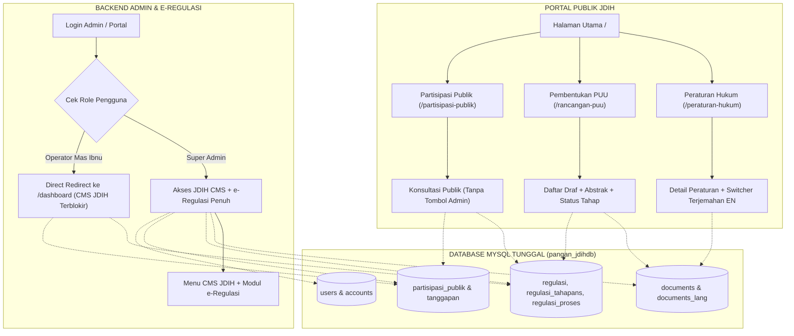

# LAPORAN INTEGRASI E-REGULASI KE DALAM JDIH KEMENKO PANGAN
**Dokumentasi Teknis dan Hasil Pengujian Terpadu**

**Terakhir Diperbarui:** 5 November 2026  
**Status Ekosistem:** **TERINTEGRASI PENUH, TERUJI, & PRODUKSI-READY**

---

## 1. Ringkasan Ekosistem Terpadu JDIH & e-Regulasi

Integrasi ini menyatukan portal publik **JDIH Kementerian Koordinator Bidang Pangan** dan aplikasi internal **e-Regulasi** ke dalam satu arsitektur terintegrasi:

---

## 2. Rincian Penyelesaian Seluruh Butir Permintaan

### A. Peraturan Terjemahan Bahasa Inggris
1. **Penyatuan Form CMS:** Form Create & Edit Peraturan Hukum (`/admin-panel/document-peraturan`) memiliki collapsible card: `Peraturan Terjemahan Bahasa Inggris (Optional)`.
2. **Metadata & Berkas:** Menyimpan judul Inggris (`translation_title`), nomor versi Inggris (`translation_no_peraturan`), abstrak Inggris (`translation_intro`), serta berkas PDF terjemahan (`translation_pdf`) dan lampiran (`translation_attachment`).
3. **Penyelarasan Multi-bahasa:** Sinkronisasi otomatis ke tabel `documents_lang` (`lang = 'en'`).
4. **Tampilan Publik:** Halaman detail menampilkan toggle pilihan bahasa (`Bahasa Indonesia` | `English Version`) secara dinamis hanya saat dokumen memiliki versi terjemahan.

### B. Perbaikan Tampilan Partisipasi Publik
1. Menghilangkan `.pub-admin-quickbar` (tombol *Kelola Partisipasi Publik* dan *Dashboard Pengajuan PUU*) dari halaman publik.
2. Menghilangkan link kelola inline dari kartu draf dan halaman detail masukan publik.
3. Desain, layout, form, kartu partisipasi, dan hitung mundur disamakan sepenuhnya dengan standar e-Regulasi.

### C. Perbaikan Error 404 & Aksesibilitas
1. Route `/galeri`, `/gallery`, dan `/videografis` terdaftar eksplisit di `routes/web.php` dan `cadmin/src/Models/Menu.php` menangani URL absolut secara aman.
2. Klasifikasi video dipetakan ke `aksesibilitas`, sehingga menu Aksesibilitas menampilkan 5 video card dan widget bantuan disabilitas tanpa error.

### D. Integrasi Penyusunan Regulasi ke Rancangan PUU & Abstrak
1. Tabel `regulasi` e-Regulasi otomatis disinkronkan ke dokumen pembentukan PUU JDIH (`master_document_id = 15`).
2. Halaman `/rancangan-puu` menampilkan:
   - Judul rancangan regulasi.
   - Badge tahapan proses penyusunan (Pengajuan, Pembahasan, Uji Publik, Harmonisasi, Penetapan).
   - Unit Pengusul / Pemrakarsa.
   - Tanggal pengusulan/update.
   - **Keterangan / Abstrak Rancangan** ditampilkan jelas dalam box informasi khusus.
   - Tombol langsung untuk memberikan masukan publik jika rancangan sedang dalam tahap partisipasi publik aktif.

### E. Penempatan Dokumen Baru / Update di Halaman Paling Awal & Paling Atas (Page 1)
1. Seluruh listing dokumen di Admin Panel dan Website Publik mengimplementasikan pengurutan prioritas:
   `ORDER BY updated_at DESC, created_at DESC, id DESC`.
2. Saat dokumen baru dibuat atau diedit, pemanggilan `$item->touch()` seketika memperbarui `updated_at`, menempatkan dokumen tersebut di **urutan pertama pada Halaman 1**.

### F. Pembuatan Menu e-Regulasi di CMS JDIH
Ditambahkan menu navigasi di sidebar CMS JDIH (`config/cadmin/menu.php`) khusus Super Admin:
- Dashboard e-Regulasi (`/dashboard`)
- Penyusunan Regulasi (`/regulasi`)
- Pengajuan PUU Baru (`/regulasi/create`)
- Moderasi Partisipasi Publik (`/admin/partisipasi-publik`)
- User e-Regulasi (`/users`)
Ditambah tombol quick-switcher di navbar atas untuk berpindah cepat antara CMS JDIH dan e-Regulasi.

### G. Pemisahan Hak Akses Khusus Operator e-Regulasi (Akun Mas Ibnu)
1. Akun Mas Ibnu (`durraniazka.herbs@gmail.com` / `ibnu`) disinkronkan ke tabel `users` dengan role `admin_operator`.
2. Saat Mas Ibnu login, sistem **langsung me-redirect ke `/dashboard`** e-Regulasi.
3. Seluruh menu CMS JDIH disembunyikan dari sidebar miliknya.
4. Middleware `cadmin/src/Http/Middleware/Admin.php` mencegat akses langsung ke `/admin-panel/*` dan mengembalikan ke `/dashboard`.

### H. Pemisahan User JDIH vs e-Regulasi
1. Manajemen user (`/users`) membedakan secara tegas kategori peran:
   - **Super Admin:** Akses penuh ke CMS JDIH dan e-Regulasi.
   - **Operator e-Regulasi:** Akses hanya pada modul penyusunan e-Regulasi.
   - **User Masyarakat:** Akses publik untuk menyampaikan aspirasi.

### I. Pembersihan Copyright Webarq
Semua teks copyright Webarq pada halaman login dan footer panel admin telah diganti menjadi teks resmi:
`© 2026 JDIH Kementerian Koordinator Bidang Pangan`.

---

## 3. Hasil Pengujian Endpoint Utama

| No | Endpoint URL | Status Code | Keterangan |
|---|---|---|---|
| 1 | `GET /` | **HTTP 200** | Beranda JDIH Kemenko Pangan |
| 2 | `GET /peraturan-hukum` | **HTTP 200** | Daftar Peraturan Hukum |
| 3 | `GET /rancangan-puu` | **HTTP 200** | Rancangan PUU & Abstrak e-Regulasi |
| 4 | `GET /partisipasi-publik` | **HTTP 200** | Partisipasi Publik Bersih (Tanpa Tombol Admin) |
| 5 | `GET /partisipasi-publik/1` | **HTTP 200** | Detail Partisipasi & Form Aspirasi |
| 6 | `GET /galeri` | **HTTP 200** | Galeri Informasi Foto |
| 7 | `GET /gallery` | **HTTP 200** | Alias Galeri |
| 8 | `GET /videografis` | **HTTP 200** | Galeri Video & Informasi |
| 9 | `GET /aksesibilitas` | **HTTP 200** | Portal Video Aksesibilitas |
| 10 | `GET /admin-panel` | **HTTP 200** | Panel Pengelolaan CMS JDIH |
| 11 | `GET /admin-panel/guest/login` | **HTTP 200** | Form Login CMS JDIH |
| 12 | `GET /peraturan-menteri-...` | **HTTP 200** | Detail Peraturan dengan Switcher English |
| 13 | `GET /dashboard` | **HTTP 200** | Dashboard e-Regulasi Terintegrasi |
